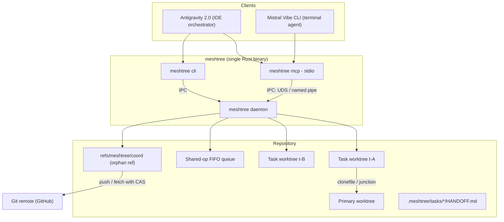
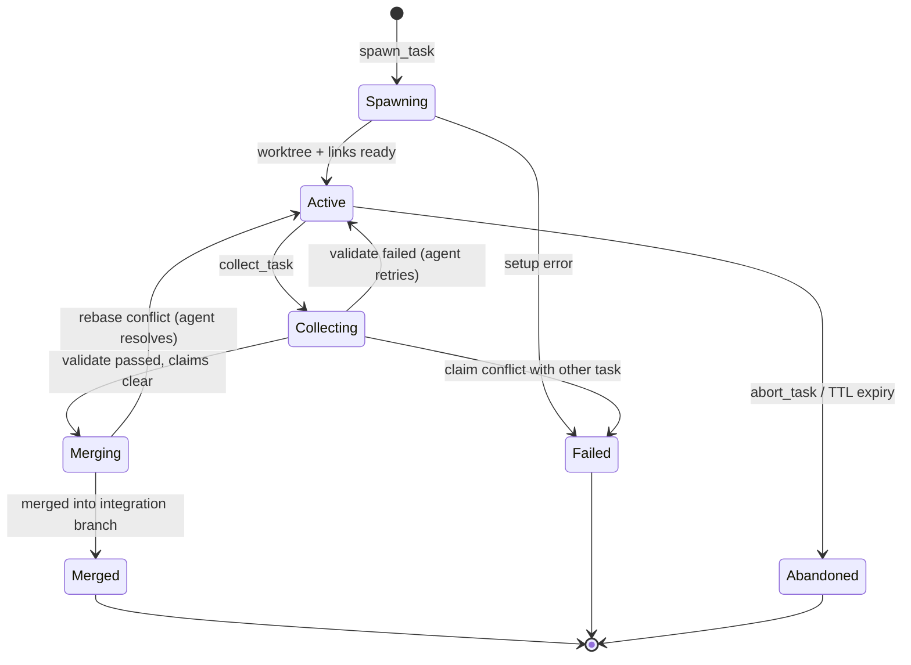
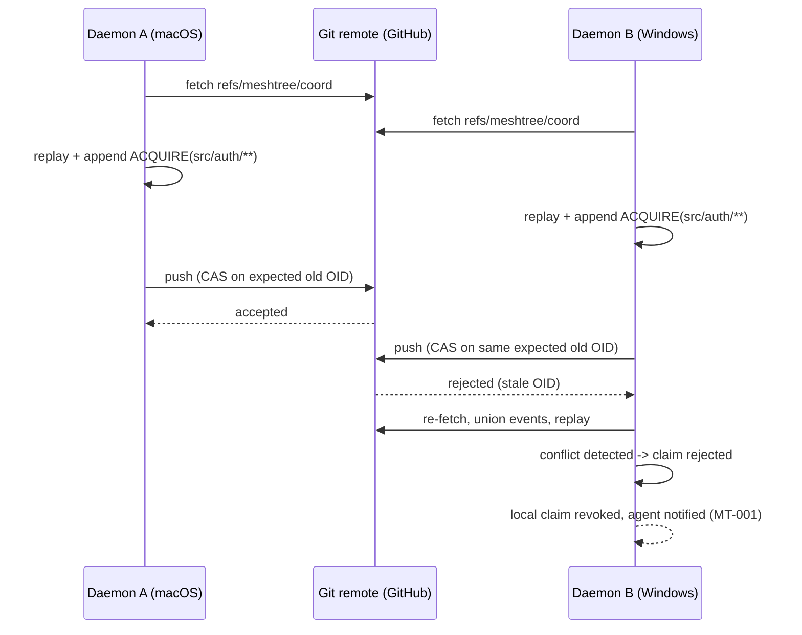
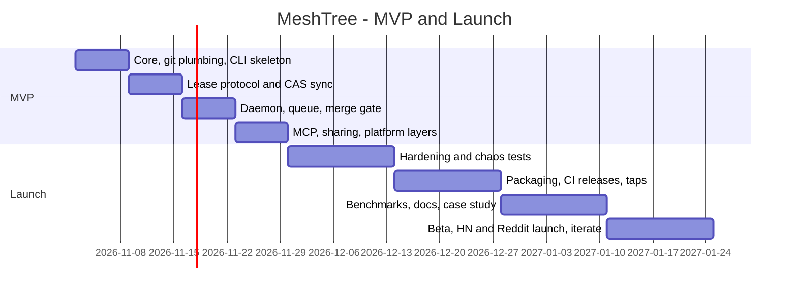

# MeshTree — Multi-Agent Workspace Coordinator

**Full Specification · v0.1 · Target: 4-week MVP, 10-week v1.0 launch**

MeshTree is a local-first, single-binary Rust daemon that lets multiple AI coding agents (an IDE orchestrator such as Google Antigravity, plus terminal agents such as Mistral Vibe CLI, Claude Code, Codex CLI) work in parallel on one repository without silently overwriting each other, thrashing shared builds, or colliding on git locks — across Windows and macOS machines synchronized through GitHub.

It is **not** an LLM context tool. It is a **concurrency and workspace-isolation layer**: part lock manager, part process supervisor, part merge queue. It treats parallel agents like an operating system treats processes — each gets an isolated workspace, claimed resources, scheduled access to shared hardware, and a structured exit.

---

## 1. Problem Statement

Running multiple coding agents against one checkout fails in well-documented ways:

1. **Silent file clobbering** — two agents in the same working directory overwrite each other's in-progress edits; the collision window is seconds, not hours.
2. **Git lock contention** — concurrent git operations on one working directory produce `fatal: Unable to create .git/index.lock`.
3. **Resource thrash** — two agents independently launch `cargo test` / `npm test` and saturate the machine.
4. **Context rot on handoff** — when quota runs out mid-feature, the next agent starts cold and re-reads the repository.
5. **Cross-machine drift** — state that lives only on one machine (a local daemon's memory) cannot coordinate agents on the user's other machine.

Existing answers are either single-ecosystem (Claude Code's `--worktree`), commercial and closed (Medley.sh, macOS-only), or blog-post guidance with no enforcement. No neutral, open-source, cross-platform tool exists at this layer.

**MeshTree's bet:** the workspace/coordination layer — not the context-retrieval layer — is the open systems-engineering frontier in agent tooling.

---

## 2. Goals

- **G1.** Isolated task workspaces: every agent task gets its own git worktree + branch, created in < 5 s.
- **G2.** Advisory file/module **claims** (leases) that propagate across machines **through git itself** — no server, no cloud service.
- **G3.** A local **FIFO queue** that serializes expensive shared operations (test suites, builds).
- **G4.** A serialized, validated **merge gate** from task branches into an integration branch, with claim-conflict checks.
- **G5.** Structured, merge-safe **handoff records** per task, with deterministic rendering into the root `AGENTS.md`.
- **G6.** Dependency sharing between worktrees with near-zero duplication (APFS clonefile on macOS, NTFS junctions on Windows).
- **G7.** Windows-correct teardown: mandatory NTFS locking (`ERROR_SHARING_VIOLATION`) never crashes a cleanup; it degrades to quarantine.
- **G8.** Production distribution: cargo install, GitHub Releases binaries for Windows/macOS/Linux, Homebrew tap, MCP directory listing, CI on all three OSes.

## 3. Non-Goals

- **No LLM context retrieval/slicing** (that is TreePrune's crowded space — deliberately abandoned).
- **No patch parsing or edit application** (mpatch/diffapply territory).
- **No cloud service, accounts, or telemetry.** Local-first; git is the only network.
- **No agent orchestration policy** — MeshTree does not decide *what* agents work on; it only guarantees *isolation, exclusivity, and order*.
- **No hard cross-machine enforcement.** Remote claims are advisory (like git-lock semantics); hard enforcement happens at the local merge gate. This is a stated design property, not a bug.

---

## 4. System Overview

One Rust binary, three surfaces: `meshtree daemon` (background service), `meshtree` CLI, and `meshtree mcp` (stdio MCP server that proxies to the daemon). All state lives in the repository (`.meshtree/` directory + one orphan git ref), so it syncs across machines for free.



**Design decision — git plumbing via the git CLI, not libgit2.** All git operations shell out to `git` (`-z` / `--porcelain` machine-readable flags) behind a `GitOps` trait. Rationale: ref-namespace plumbing, worktree, and push CAs behave subtly differently in libgit2/gix; the CLI is the reference implementation, easier to debug, and available everywhere git is. The trait keeps a future in-process backend possible.

---

## 5. On-Disk Layout

```
<repo>/
├── AGENTS.md                      # generated "Active Sessions" block lives here
└── .meshtree/                     # gitignored except where noted
    ├── config.toml                # committed by the user (project policy)
    ├── daemon.lock                # singleton lock: pid, boot_id, machine_id
    ├── daemon.sock                # macOS/Linux UDS  (Windows: named pipe)
    ├── worktrees/
    │   └── t-01J…/                # task worktrees live here
    ├── tasks/
    │   └── t-01J…/
    │       ├── task.json          # local daemon state (machine-local)
    │       ├── HANDOFF.md         # committed on the task branch (see §11)
    │       └── handoff.json
    └── quarantine/               # worktrees that failed teardown (§10)
```

Coordination state that must survive machine boundaries lives in an **orphan git ref** — never in the working tree:

```
refs/meshtree/coord
├── leases/<sha1(normalized-path)>.json   # derived snapshot (fast remote reads)
├── log/<ULID>.json                        # append-only event log (source of truth)
└── tasks/<task-id>.json                    # cross-machine task registry
```

---

## 6. Configuration — `.meshtree/config.toml` (committed)

```toml
[project]
base_branch = "main"
integration_branch = "meshtree/integration"
validate = ["npm test"]            # run inside the task worktree before merge
promote_validate = ["npm test"]    # run on integration branch before promote

[lease]
ttl_secs = 900                     # claim expires if not heartbeaten
heartbeat_secs = 300
skew_grace_secs = 600              # cross-machine clock-skew allowance

[[share]]                          # dependency sharing (§9)
source = "node_modules"
strategy = "auto"                  # auto | clonefile | junction | symlink | none

[[share]]
source = "target"
strategy = "none"                  # cargo target stays per-worktree; queue serializes

[queue.test]
concurrency = 1                    # serialized shared operations
command = "npm test"

[queue.build]
concurrency = 1
command = "npm run build"

[machine]                          # optional; auto-derived from OS machine-id if absent
id = "mc-lucas-mac"
```

---

## 7. Core Data Model

### Task

```json
{
  "id": "t-01JAXGZK7Q4D3RT2WFH8MB3VQY",
  "name": "fix-auth-middleware",
  "agent": "vibe-cli",
  "machine": "mc-lucas-win",
  "branch": "meshtree/t-01JAX…",
  "worktree": ".meshtree/worktrees/t-01JAX…",
  "base": "main",
  "created_at": "2026-11-03T14:02:11Z",
  "claims": ["src/auth/**", "tests/auth/**"],
  "status": "active"
}
```

Statuses: `spawning → active → collecting → merging → merged | failed | abandoned`. See §8 state machine.

### Lease (claim)

One lease per normalized path pattern, per holder task:

```json
{
  "path": "src/auth/**",
  "task": "t-01JAX…",
  "machine": "mc-lucas-mac",
  "acquired_at": "2026-11-03T14:05:00Z",
  "ttl_secs": 900,
  "last_heartbeat": "2026-11-03T14:15:00Z"
}
```

### Path patterns & conflict rule

- Normalized to forward slashes, no leading `./`, `**` = any depth, `*` = within one segment.
- **Two claims conflict** if either claim's pattern matches the other claim's *canonical literal* (the pattern with all wildcards replaced by a reserved probe segment), **or** either pattern is a directory-prefix of the other.
- This is a **conservative over-approximation**: false positives (over-blocking) are acceptable; false negatives (missed conflicts) are not.

### QueueTicket

```json
{
  "id": "q-01JAY…",
  "queue": "test",
  "task": "t-01JAX…",
  "position": 2,
  "granted": false,
  "granted_at": null
}
```

---

## 8. Workspace Lifecycle



### `spawn` (create task)

1. Allocate `task-id = "t-" + ULID`.
2. `git worktree add -b meshtree/<task-id> .meshtree/worktrees/<task-id> <base>`.
3. Apply the dependency-share map (§9): clonefile/junction shared dirs into the new worktree.
4. Register the task locally (`.meshtree/tasks/…/task.json`) and in the coordination ref (`tasks/<id>.json`).
5. Return worktree path + branch to the calling agent. **Budget: < 5 s** on a repo with a 2 GB `node_modules`.

### `collect` (finish task)

1. Enter `collecting`. Run `validate` commands **inside the task worktree, routed through the shared-op queue**.
2. **Claim check:** `git diff --name-only <base>...<task-branch>` must not intersect any *other* active task's claims. On overlap → `failed` with a conflict report naming the other task.
3. Acquire the **merge mutex** (local semaphore, one merge at a time per machine).
4. Merge task branch → `meshtree/integration` (never `main` directly). On non-fast-forward from the remote: fetch, replay-merge, retry (bounded ×5).
5. Run `promote_validate` on integration. Release claims, append release events, clean up the worktree (§10 teardown), transition to `merged`.
6. `meshtree promote` (manual or CI) fast-forwards `main` from integration after full validation — the human-controlled gate.

### `abort` / `prune`

`abort` discards a task (worktree removed with teardown rules, claims released). A daemon sweeper transitions tasks with no heartbeat for `ttl_secs × 4` to `abandoned` and quarantines their worktrees.

---

## 9. Lease Protocol — Cross-Machine Claims via an Orphan Git Ref

**The hard requirement (Trap 1):** coordination state must never live on tracked branches. Committing lease files to working branches would turn every lock cycle into a commit/push/pull with non-fast-forward merge storms between machines. Instead, MeshTree uses a single orphan ref, `refs/meshtree/coord`, pushed and fetched with compare-and-swap semantics. It never touches the working tree and never creates merge commits.

### Event log (source of truth)

Every claim action is an append-only event, uniquely named by ULID:

```json
{
  "id": "01JAY7K2N8…",
  "type": "ACQUIRE",
  "path": "src/auth/**",
  "task": "t-01JAX…",
  "machine": "mc-lucas-mac",
  "ts": "2026-11-03T14:05:00.500Z",
  "counter": 4821,
  "ttl_secs": 900
}
```

Event types: `ACQUIRE`, `RELEASE`, `HEARTBEAT`, `EXPIRE_SWEEP` (any machine may emit a sweep for an expired lease; idempotent).

**Ordering key:** `(ts, counter, machine, id)`. Expiry is evaluated against the *holder's* timestamps plus `skew_grace_secs`, so clock skew between machines degrades gracefully.

### Deterministic replay (lease table derivation)

1. Union all events in the ref's `log/` tree (union is conflict-free: ULID filenames are unique).
2. Sort by ordering key.
3. Replay: `ACQUIRE` wins a free or expired path; a conflicting later `ACQUIRE` is recorded as `REJECTED` (kept in the log for audit; the claiming daemon is notified and revokes its local claim).
4. `leases/*.json` is rewritten as a derived snapshot for fast reads by other machines.

Any two machines replaying the same log derive **byte-identical lease tables** — this property is unit- and property-tested.

### Atomic update via CAS

Local `git update-ref refs/meshtree/coord <new> <expected-old>` guarantees single-machine atomicity. Across machines, the push is the CAS:

```bash
git push origin refs/meshtree/coord --force-with-lease=refs/meshtree/coord:<expected-old-oid>
```

On rejection (another machine won the race), the loser re-fetches, merges its pending events into the fetched tree, replays, and retries (bounded ×5 with jitter). **Local operations are never blocked by network state**: pushes and fetches are best-effort with a dirty-flush queue; `meshtree sync` forces a flush.



### Enforcement model (honesty clause)

- **Same machine:** the daemon is the single arbiter; claims are checked synchronously in every `spawn`/`collect`/`claim` call.
- **Across machines:** claims are advisory. A losing machine may keep editing in its isolated worktree — it cannot corrupt anything — but its `collect` is rejected at the merge gate if its diff intersects another active claim. MeshTree converts cross-machine races from *silent data loss* into *an explicit, reported merge-time conflict*.

---

## 10. Platform Concurrency Behavior

### Windows mandatory file locking (Trap 2)

macOS uses advisory POSIX locking: an open read handle does not stop a `worktree remove`. Windows does not: a file held by Antigravity (open tab, watcher, language server) causes teardown to fail with `ERROR_SHARING_VIOLATION` (Win32 32) / `ERROR_ACCESS_DENIED` (5).

MeshTree's teardown pipeline:

1. **Pre-open discipline:** every file MeshTree creates opens with `FILE_SHARE_READ | FILE_SHARE_WRITE | FILE_SHARE_DELETE`.
2. **Retry with backoff:** teardown retries with exponential backoff (250 ms → 8 s, ~6 attempts).
3. **Quarantine:** on persistent failure, move the worktree (same-volume `MoveFileEx`, no cross-volume copy) to `.meshtree/quarantine/<task>/` and mark the task `merged` with a quarantine note. Quarantine is never on the failure path of a merge — cleanup failure must not fail the task.
4. **GC sweep:** the daemon retries quarantined trees at idle; as a last resort registers `MOVEFILE_DELAY_UNTIL_REBOOT`.

### IPC

| | macOS / Linux | Windows |
|---|---|---|
| Transport | Unix domain socket `.meshtree/daemon.sock` | Named pipe `\\.\pipe\meshtree-<repo-hash-16>` |
| Framing | Newline-delimited JSON (NDJSON) | Same |
| Singleton | `daemon.lock` with pid + boot-id + machine-id; stale lock detection | Same + `CreateMutex` belt-and-braces |

Request/response shape: `{"id": 7, "method": "claim_paths", "params": {…}}` → `{"id": 7, "ok": true, "result": {…}}` or `{"id": 7, "ok": false, "error": {"code": "MT-001", "message": "…"}}`.

### Crash safety

The daemon journals state transitions (spawn/claim/collect/merge) to a write-ahead log inside `.meshtree/`; on restart it replays the WAL, adopts orphaned tasks, releases leases whose holder process no longer exists (pid + boot-id check), and re-enters idle. Target: crash recovery < 2 s, zero orphaned `index.lock`.

---

## 11. Dependency Sharing (Trap 3)

Fresh worktrees break builds (missing `node_modules`/`target`) or duplicate gigabytes per task. MeshTree makes sharing part of the `spawn` lifecycle, per the `[[share]]` config:

| Content | macOS | Windows | Default policy |
|---|---|---|---|
| `node_modules` (npm) | symlink → primary worktree | **junction** (`mklink /J` semantics; no admin rights needed) | shared |
| pnpm store | global store already shared; `.pnpm` virtual store symlinked | junction | shared |
| `target` (Rust) | per-worktree (cargo's own flock + cache deps) | per-worktree | **not shared**; build queue serializes concurrent cargo runs |
| `.venv` (Python) | never shared (path-embedded interpreters); recreated from lock | same | recreate |
| Read-only caches (`~/.cargo`, turbo, next cache) | `clonefile` (`cp -c`, APFS copy-on-write) | junction | shared |

Rules baked into the implementation:

- **Junctions on Windows, not symlinks** — symlinks need Developer Mode; junctions work for any user.
- **Realpath awareness:** tools that resolve junctions to absolute paths (some bundlers, watchpack) are listed in a documented compatibility appendix; `strategy = "none"` disables sharing per-directory.
- **Budget:** link creation < 100 ms per shared directory; total `spawn` < 5 s on a 2 GB `node_modules` repo (measured in the benchmark suite).

---

## 12. Shared-Operation Queue

Per-queue FIFO with `concurrency = N` from config. Agents call `request_shared_op(queue)` → receive a ticket → are granted in order → hold the slot until the command exits or the ticket TTL lapses (dead-process detection via pid + boot-id, so a killed agent never wedges the queue). Queues are **local** per machine — two machines may run their own test suites concurrently; what cross-machine correctness requires is *merge* serialization, handled by the merge gate.

---

## 13. Handoff Records & AGENTS.md Integration

Per-task handoff lives **on the task branch** (`.meshtree/tasks/<id>/HANDOFF.md` + `handoff.json`), so it merges naturally with the work and never conflicts across tasks:

```json
{
  "objective": "Add idempotency checks to Stripe webhook handler",
  "state": "mid-implementation",
  "done": ["idempotency-key column added", "migrations written"],
  "next": ["wrap handler in transaction", "write replay test"],
  "failing_tests": ["webhooks::test_double_charge"],
  "decisions": [{ "what": "use upsert instead of lock", "why": "avoids row lock contention" }],
  "ruled_out": ["redis-based dedupe — rejected as non-local-first"]
}
```

`meshtree render-agents` (and the MCP tool) compiles all *active* tasks' handoffs into a deterministic, bounded block inside the root `AGENTS.md`:

```markdown
<!-- meshtree:active-sessions begin -->
<!-- Generated by MeshTree. Do not edit between markers. -->
## Active Sessions
- [t-01JAX…] fix-auth-middleware (vibe-cli, mc-lucas-win): mid-implementation.
  Next: wrap handler in transaction. Failing: webhooks::test_double_charge.
<!-- meshtree:active-sessions end -->
```

Rolling summary capped at 10 lines by default (configurable) — this replaces the hand-maintained handoff state with a generated, always-current view. Deterministic ordering (task id) keeps git diffs — and prompt caches — stable.

---

## 14. CLI Reference

```
meshtree daemon                        # start the background service
meshtree init                          # write .meshtree/config.toml template
meshtree spawn <name> [--base <ref>] [--agent <id>] [--claim <glob>…]
meshtree collect <task-id> [--message <msg>]
meshtree abort <task-id>
meshtree status [task-id] [--json]
meshtree claim <task-id> <glob>…       # add claims to an active task
meshtree release <task-id> <glob>…
meshtree queue <queue-name> request --task <task-id>
meshtree handoff <task-id> --json-file <path> | --set key=value…
meshtree render-agents                 # regenerate AGENTS.md block
meshtree sync                          # flush/pull coordination ref now
meshtree promote                       # ff main <- integration (after validation)
meshtree prune [--stale-only]          # quarantine/GC abandoned worktrees
```

Exit codes: `0` ok · `10` usage · `20` task/lease error (see §16) · `30` daemon error · `40` platform error (locked file, quarantine).

## 15. MCP Server (`meshtree mcp`, stdio)

The MCP process is a thin proxy: it holds no state, connects to the daemon over IPC, and dies cleanly with the client without ever killing the daemon.

| Tool | Input (key fields) | Output |
|---|---|---|
| `spawn_task` | `name`, `base?`, `agent?`, `claims?[]` | `task_id`, `worktree_path`, `branch` |
| `task_status` | `task_id?` | task record(s) |
| `list_tasks` | `active_only?` | task records |
| `claim_paths` | `task_id`, `paths[]`, `ttl_secs?` | granted/rejected per path |
| `release_paths` | `task_id`, `paths[]` | released |
| `request_shared_op` | `task_id`, `queue`, `command_override?` | `ticket_id`, `position`, `granted` |
| `commit_handoff` | `task_id`, `objective?`, `state?`, `done?[]`, `next?[]`, `failing_tests?[]`, `decisions?[]`, `ruled_out?[]` | rendered `HANDOFF.md` path |
| `collect_task` | `task_id`, `message?` | merge result / conflict report |
| `abort_task` | `task_id` | final status |
| `render_agents_block` | — | rendered summary |
| `sync` | — | ref sync result |

All tools return MeshTree error codes (§16) as MCP tool errors so agents can self-correct (e.g., on `MT-001` claim conflict, choose different paths or negotiate).

## 16. Error Model

| Code | Meaning | Agent guidance |
|---|---|---|
| `MT-001` | claim conflict (path held by another task) | pick different paths or wait |
| `MT-002` | lease expired mid-use | re-acquire before editing |
| `MT-003` | coordination-ref CAS rejected (retryable) | internal; daemon retries |
| `MT-010` | daemon unreachable | `meshtree daemon` not running |
| `MT-011` | stale daemon lock | auto-recovered; informational |
| `MT-020` | file locked by another process (Windows) | retry or wait for GC |
| `MT-021` | worktree quarantined | cleanup deferred; work is safe |
| `MT-030` | validation failed | fix tests, re-collect |
| `MT-031` | merge conflict with integration | resolve on task branch, retry |
| `MT-032` | claim-overlap at merge gate | coordinate with the other task |
| `MT-040` | share-link failed | strategy fell back to `none` |
| `MT-050` | config invalid | check `.meshtree/config.toml` |

## 17. Security & Trust Boundary

- MeshTree executes `validate`/queue commands defined in the **committed** config — project owners control what runs; agents cannot inject arbitrary commands via queue requests (overrides limited to arguments allow-listed per queue).
- The coordination ref is signed by whoever can push to the remote — same trust model as the code itself. Lease spoofing requires repo write access.
- Daemon socket is restricted: on Unix, socket file permissions `0600` + parent directory check; named pipe uses per-user ACLs on Windows. No TCP listener, ever.
- Worktree paths under `.meshtree/` are excluded from agent write-claims to prevent an agent from editing coordination state.

---

## 18. Testing Strategy & Benchmark Suite

### Unit tests (`meshtree-core`, pure, no fs)

- Lease replay determinism: randomized event streams (property-based, `proptest`) → identical lease tables regardless of insertion order.
- TTL expiry under injected clock skew (holder-ts semantics + grace).
- Pattern conflict rule: exhaustive case table for glob overlap; **zero false negatives** asserted.
- Handoff → AGENTS.md rendering: byte-stable snapshots.

### Integration tests (`assert_cmd`, temp git repos)

- Two client processes racing claims through one daemon — exactly one wins.
- **Two-clone simulation** of cross-machine: two clones with a `file://` remote racing CAS pushes — loser recovers within retry bound; final lease tables identical.
- Full lifecycle: spawn → claim → handoff → collect → merged, with the generated `AGENTS.md` asserted.
- Windows CI: open a handle with no share flags on a worktree file, run teardown, assert quarantine (never a failed merge).

### Chaos tests

- `SIGKILL` the daemon mid-merge → WAL replay recovers; no orphaned `index.lock`; recovery < 2 s.
- Stale `daemon.lock` with live pid vs dead pid → correct adoption.
- Clock-skew injection ±30 min → grace logic holds; no premature sweeps.

### Benchmark suite (published results, reproducible)

| Scenario | Metric |
|---|---|
| Spawn on 2 GB `node_modules` repo | < 5 s (link-based sharing) |
| Claim acquire (local) | p95 < 50 ms |
| Cross-machine claim CAS round | p95 < 2 s (GitHub remote RTT) |
| Two agents, one repo, 20-min session | silent-overwrite incidents: **0** (baseline without MeshTree: N>0, reported) |
| `index.lock` collisions | 0 with queue vs baseline |
| Crash recovery | < 2 s |

Coverage bar for `meshtree-core`: ≥ 85%.

## 19. Packaging & Distribution

- **Cargo:** `cargo install meshtree` (single binary, `cargo-dist` release automation).
- **GitHub Releases:** static binaries for `x86_64-pc-windows-msvc`, `aarch64-apple-darwin`, `x86_64-unknown-linux-gnu` from a three-OS CI matrix.
- **Homebrew tap** (`tap` repo, `brew install <user>/tap/meshtree`).
- **Scoop / winget manifests** for Windows.
- **MCP listing:** an `npx` shim wrapper (`meshtree-mcp` package that downloads/launches the binary) so MCP-directory configs work with a one-line install.
- CI gates: fmt + clippy `-D warnings`, `cargo test` on all three OSes, `cargo-audit`, release smoke test on tagged commits.

---

## 20. Roadmap

### MVP — Weeks 1–4 (2026-11-02 → 2026-11-28)

| Week | Deliverable | Exit criteria |
|---|---|---|
| **1** | Crate scaffold (`core` / `platform` / bin), config loading, `GitOps` trait + CLI-git backend (worktree add/remove, ref read/CAS), CLI: `init`, `spawn`, `status`, `abort` | `meshtree spawn` produces a working linked worktree on macOS + Windows; CI matrix green from day 1 |
| **2** | Lease protocol: event log, deterministic replay, CAS push/pull, heartbeats, `claim`/`release`, conflict rule | Two-clone CAS race test passes; property tests for replay determinism |
| **3** | Daemon: IPC socket (UDS + named pipe), singleton lock, WAL, shared-op queue, merge gate + integration branch + validate, `collect` | Full lifecycle integration test green; chaos kill-mid-merge recovers |
| **4** | MCP server (all §15 tools), dependency sharing (junction/clonefile), Windows teardown + quarantine, handoff records + AGENTS.md rendering | Two real agents (Antigravity + Vibe CLI) run the §18 benchmark scenario end-to-end |

### Launch — Weeks 5–10 (2026-11-30 → 2027-01-08)



- **Weeks 5–6:** chaos suite completion, clock-skew simulation, compatibility appendix for junction-realpath tools, docs (protocol spec page, architecture post).
- **Weeks 7–8:** `cargo-dist` release pipeline, Homebrew tap + Scoop, MCP directory + npx shim, benchmark results page, dogfood case study from the real two-machine setup.
- **Weeks 9–10:** beta tag, Show HN + r/programming + r/ClaudeAI launch, issue triage, v1.0.

## 21. Risks & Mitigations

| Risk | Impact | Mitigation |
|---|---|---|
| Junction/realpath incompatibility with some node tooling | broken builds in task worktrees | per-directory `strategy = "none"`; compatibility appendix; benchmark on real repos |
| Cross-machine claim race lost *after* agent started editing | wasted work | claims are advisory by design; merge gate reports conflict before any damage; agent rebases onto winner's changes |
| Clock skew > grace window | premature sweep | holder-authoritative expiry + generous grace; sweeps idempotent; all sweep events audited in log |
| Ref-push rejection loops under contention | latency spikes | bounded retries with jitter; local ops never block; dirty-flush queue |
| Windows handle enumeration unavailable for diagnostics | can't name the locker | quarantine path doesn't require it; error names the file path |
| Scope creep back into context-tooling (TreePrune instincts) | missed deadline | §3 Non-Goals is a contract; feature requests deferred to post-1.0 |
| Solo developer, school schedule | schedule risk | 4-week MVP is deliberately cut to §20's exit criteria; anything after week 4 is polish, not core |

## 22. Success Metrics (v1.0)

1. **0** silent overwrites / lock collisions across the full benchmark suite (vs. reported baseline without MeshTree).
2. `spawn` < 5 s and claim p95 < 50 ms locally on the dogfood repo.
3. Crash recovery < 2 s, zero orphaned locks in chaos runs.
4. ≥ 85% core coverage; three-OS CI green on every release.
5. External validation: at least one non-author contributor or 100+ GitHub stars within 4 weeks of launch (signal, not vanity: it measures whether the category thesis is right).

---

## Appendix A — Key git plumbing (implementation reference)

```bash
# read coordination ref
git rev-parse refs/meshtree/coord
git ls-tree -r <oid>                       # inventory log/ + leases/
git cat-file -p <blob>                     # read an event

# local atomic update (CAS)
git update-ref refs/meshtree/coord <new-oid> <expected-old-oid>

# cross-machine CAS
git fetch origin refs/meshtree/coord
git push origin refs/meshtree/coord \
  --force-with-lease=refs/meshtree/coord:<expected-old-oid>

# worktree lifecycle
git worktree add -b meshtree/<task-id> .meshtree/worktrees/<task-id> <base>
git worktree remove --force .meshtree/worktrees/<task-id>
```

## Appendix B — Crate layout

```
meshtree/
├── crates/
│   ├── meshtree-core/     # lease table, replay, task model, queue, handoff (pure; no fs, no git)
│   ├── meshtree-platform/ # IPC (UDS/named pipe), locks, junction/clonefile, quarantine, WAL
│   └── meshtree/          # bin: daemon, cli (clap), mcp (rmcp); git plumbing behind GitOps trait
├── xtask/                 # benchmark scenario runner
└── .github/workflows/     # ci.yml (3-OS matrix), release.yml (cargo-dist)
```

`meshtree-core` is the invariant-protected heart: everything in it is deterministic and property-tested; platform and git concerns live behind traits at the binary crate boundary.
