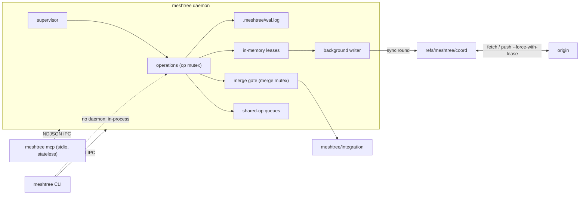
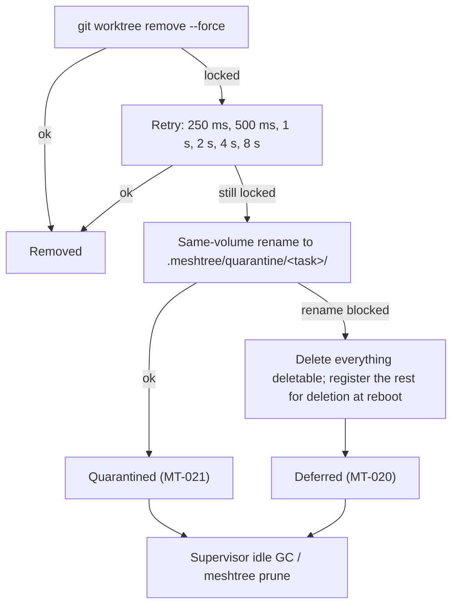

# MeshTree Architecture Reference

This document explains how the `meshtree` binary implements the protocol in [`protocol.md`](protocol.md): how the crates are split, how the daemon is put together, and the three mechanisms that keep a crash or a locked file from losing work. Those are the write-ahead log, the serialized merge gate, and teardown on NTFS. `SPEC.md` is authoritative; this document describes the code that implements it.

- **Authority:** `SPEC.md` §4, §8, §10–§13, §17, Appendix B; `ADR-0001`, `ADR-0002`, `ADR-0005`, `ADR-0006`, `ADR-0007`, `ADR-0008`, `ADR-0009`, `ADR-0010`.
- **Examples are tested** the same way as in `protocol.md`: ` ```json <kind> ` blocks are parsed by `docs_json_examples_parse_against_core_types`.

## Contents

1. [Crates](#1-crates)
2. [The daemon](#2-the-daemon)
3. [Write-ahead log](#3-write-ahead-log)
4. [Claim path (`ADR-0009`)](#4-claim-path-adr-0009)
5. [Merge gate](#5-merge-gate)
6. [Shared-operation queue](#6-shared-operation-queue)
7. [Teardown on NTFS (Trap 2)](#7-teardown-on-ntfs-trap-2)
8. [Dependency sharing (Trap 3)](#8-dependency-sharing-trap-3)
9. [Handoffs and `AGENTS.md`](#9-handoffs-and-agentsmd)
10. [Compaction in the writer (`ADR-0010`)](#10-compaction-in-the-writer-adr-0010)
11. [Cloud and ephemeral participants (`ADR-0008`)](#11-cloud-and-ephemeral-participants-adr-0008)

---

## 1. Crates

```text
crates/
├── meshtree-core/      pure: task model + §8 state machine, lease events + replay,
│                       path patterns, queue, handoff rendering, config, timestamps
├── meshtree-platform/  OS and git: GitOps (git CLI), coordination store (CAS sync),
│                       IPC (UDS / named pipe), daemon.lock, WAL, teardown, share links
└── meshtree/           the binary: CLI (clap), daemon, MCP stdio server
```

- **`meshtree-core` does no I/O.** It has no filesystem, process or network access and no clock, so everything in it is deterministic and property-tested. Its coverage is enforced in CI at ≥ 85% of lines (`T-031`).
- **All git goes through `GitOps`** (`ADR-0001`), a trait whose only backend shells out to the `git` CLI with machine-readable flags. Locale-dependent output is never parsed (`T-044`).
- **`meshtree` is a thin surface.** The CLI, the daemon and `meshtree mcp` share one set of operations. With a daemon running, the CLI and MCP are IPC clients. Without one, the CLI runs the same operation in-process, arbitrated by the coordination-ref CAS.



## 2. The daemon

One daemon per repository per machine. Startup is strictly ordered, so no client ever sees a half-recovered daemon:

1. **Load config** (`MT-050` on invalid) and derive the machine id.
2. **Take `daemon.lock`.** Acquisition needs two independent locks to agree:
   - **A kernel guard.** On Unix, `flock(LOCK_EX | LOCK_NB)` on the file itself, unlocked explicitly on drop so a forked child cannot inherit it. On Windows, the named mutex `Local\meshtree-<hash16>`. Either way the OS releases it when the holder dies, including after `SIGKILL` or `TerminateProcess`.
   - **A lock record**, `{"pid", "boot_id", "machine_id"}`. A live pid on the current boot refuses acquisition. A dead pid, a previous boot, or an unreadable record is stale and is adopted (`MT-011`). A record from another machine *and* another boot cannot be probed and is refused.

   The record is rewritten in place and cleared on release, never unlinked: unlinking would hand a second process a fresh inode while the first still holds `flock` on the old one.
3. **Open the WAL** (§3), truncating a torn tail, and replay it into per-task state.
4. **Recover** (§3.3), including re-queuing acknowledged lease events that the coordination ref lacks.
5. **Bind the IPC endpoint** ([`protocol.md` §9.1](protocol.md#91-transport)). On Unix the socket's directory is checked for ownership and permissions and the socket is created `0600`. On Windows the pipe gets an owner-and-SYSTEM DACL and rejects remote clients.
6. **Serve.** Each connection gets a thread. Every mutating request runs under one **operation mutex**, so two racing clients are serialized and exactly one of two conflicting claims wins.

Two long-lived threads run beside the request handlers:

| Thread | Period | Work |
|---|---|---|
| Background writer | 10 ms tick | Commits pending lease events (§4), fetches every `heartbeat_secs / 4` (1–30 s), retries a deferred push every 5 s. |
| Supervisor | `heartbeat_secs` | Flushes pending events, then writes `HEARTBEAT` events for the claims of tasks seen within `ttl_secs × 4`. Moves tasks unseen for longer to `abandoned` and releases their claims. Retries deleting quarantined trees (§7). Every status change is published to `tasks/<id>.json` (`T-047`). |

A task's "last seen" time is its latest task-scoped request, or the daemon start if it has made none.

## 3. Write-ahead log

`.meshtree/wal.log` journals every state transition the daemon makes, so a crash at any instant can be repaired on the next start (§10 Crash safety).

### 3.1 Frame format

One frame per line:

```text
<len: 8 lowercase hex> SP <crc32(json): 8 lowercase hex> SP <json> LF
```

`json` is the compact serialization of one entry and never contains a raw LF. Each append writes one whole frame and `fsync`s before returning, so a crash can tear only the **last** frame. On open, MeshTree replays the longest valid prefix:

| Damage | Handling |
|---|---|
| Invalid last frame (bad length, CRC or framing) with nothing valid after it | Torn tail: truncated and reported, so later appends start on a clean boundary. |
| Invalid frame **followed by** a valid one | Corruption, not a crash artefact: refuse to open (`InvalidData`). |
| CRC matches but the JSON is not a known entry | Written by a newer or broken writer: refuse to open, rather than discard journaled state. |

### 3.2 Entries

Each entry has a `seq` (strictly increasing from 1 within the file), `at_ms` (Unix milliseconds from the injected clock), and an `op` tag. Rust type: `meshtree_platform::wal::WalEntry`.

| `op` | Journaled when | Fields |
|---|---|---|
| `spawn` | A task enters `spawning` | `task`, `branch`, `worktree`, `base` |
| `transition` | Any other §8 edge (collect, merge, abort, sweep, recovery) | `task`, `from`, `to` |
| `claim` / `release` | Claims are added to or removed from a task | `task`, `paths` |
| `events` | Before a claim or release is acknowledged (`ADR-0009`) | `task`, `events` (full lease events) |

```json wal-entry
{"seq": 1, "at_ms": 1793800931000, "op": "spawn", "task": "t-01JAXGZK7Q4D3RT2WFH8MB3VQY", "branch": "meshtree/t-01JAXGZK7Q4D3RT2WFH8MB3VQY", "worktree": ".meshtree/worktrees/t-01JAXGZK7Q4D3RT2WFH8MB3VQY", "base": "main"}
```

```json wal-entry
{"seq": 2, "at_ms": 1793800932000, "op": "transition", "task": "t-01JAXGZK7Q4D3RT2WFH8MB3VQY", "from": "spawning", "to": "active"}
```

```json wal-entry
{"seq": 3, "at_ms": 1793801100500, "op": "events", "task": "t-01JAXGZK7Q4D3RT2WFH8MB3VQY", "events": [{"id": "01JAY7K2N8QWERTZ5XC4V6B9MD", "type": "ACQUIRE", "path": "src/auth/**", "task": "t-01JAXGZK7Q4D3RT2WFH8MB3VQY", "machine": "mc-lucas-mac", "ts": "2026-11-03T14:05:00.500Z", "counter": 1793801100500000000, "ttl_secs": 900}]}
```

```json wal-entry
{"seq": 4, "at_ms": 1793801100501, "op": "claim", "task": "t-01JAXGZK7Q4D3RT2WFH8MB3VQY", "paths": ["src/auth/**"]}
```

`events` entries do not change the replayed task state; the `claim` and `release` entries that follow them do. WAL replay records anomalies, such as an edge that is not legal from the journaled state, and skips them with a note instead of failing.

### 3.3 Recovery

Recovery runs after WAL replay and before the endpoint is bound:

1. **Reconcile.** `task.json` is written before its WAL entry, so a crash can leave the WAL one edge behind. Tasks the WAL never saw are adopted along their §8 path, and a WAL status that is one legal edge behind is advanced.
2. **Clear stale git locks.** This covers the `index.lock` of the integration worktree and of every interrupted task worktree, plus the lock files of `refs/heads/<integration>` and `refs/meshtree/coord`. A git child of the killed daemon may still be finishing, so a lock is removed only once it is at least 1 s old. The primary worktree's index is never touched.
3. **Reset the integration worktree** to the integration tip. An interrupted merge never reached the branch, because the ref moves only after `promote_validate` (§5).
4. **Settle interrupted collects.** A `merging` task whose branch is already in the integration branch crashed after the ref moved: its claims are released, its worktree removed, and it becomes `merged`. Every other `collecting` or `merging` task returns to `active`, so its agent can collect again.
5. **Re-queue lease events.** Journaled `events` missing from the coordination ref are re-queued as pending, matched by event id, so no acknowledged claim is lost (`chaos_wal`).

Queue tickets live only in daemon memory, so they do not survive the crash that would orphan them. Leases are task-scoped, not process-scoped. Targets: recovery < 2 s and zero orphaned `index.lock` (§18; `ping` reports `recovery_ms`).

## 4. Claim path (`ADR-0009`)

[`protocol.md` §7](protocol.md#7-daemon-claim-path-adr-0009) specifies the observable behaviour. Inside the daemon:

```mermaid
sequenceDiagram
  participant C as Client (CLI / MCP)
  participant H as Request handler
  participant L as Leases (memory)
  participant W as WAL
  participant B as Background writer
  participant R as refs/meshtree/coord
  C->>H: claim_paths
  H->>L: refresh (compare ref tip, no git)
  H->>L: decide(batch)
  alt conflict
    H-->>C: MT-001
  else granted
    H->>W: append events + claim, fsync
    H->>L: accept(batch) → pending
    H-->>C: ok, coord: pending
    B->>L: take pending (≤ 250 ms)
    B->>R: sync round (fetch, union, replay, CAS, push)
    B->>L: flushed(new log); revoke lost claims
  end
```

- **Leases** holds the log as of a ref tip, its cached replay (`base`), and the acknowledged but uncommitted events (`pending`). The CLI, heartbeats and merge-gate releases write the ref directly, so before each decision the ref file is compared with the tip the log was read at, and the log is reloaded only if the tip moved.
- **Folding onto the cache.** Folding new events onto `base` gives exactly what a full replay would, as long as the new events sort after every logged event. That holds for events created now; otherwise a full replay runs. A fast negative pre-check (patterns whose first literal segments differ cannot conflict) avoids the full pattern test for most pairs, without introducing false negatives.
- **Only one flush at a time.** While the daemon's own writer is committing, `refresh` waits for the writer's result instead of reloading a log that is about to be replaced.
- **Operations that read the ref flush first.** `collect`, `sync`, heartbeats and sweeps commit pending events before they run, so the merge gate's claim check sees every acknowledged claim.

## 5. Merge gate

`collect_task` walks one task through the §8 diagram (`merge_gate.rs`):

| Step | Action | Failure |
|---|---|---|
| 1 | `active → collecting`. Run `project.validate` in the task worktree while holding a slot of the `validate` shared-op queue (§6). | `collecting → active`, `MT-030` with the output tail |
| 2 | **Claim check.** Every path in `git diff --name-only <base>...<branch>` is checked against every *other* task's live lease. | Claims released, `collecting → failed`, `MT-032` naming the holder |
| 3 | Take the per-machine **merge mutex**; `collecting → merging`. | — |
| 4 | Merge the task branch `--no-ff` in the integration worktree `.meshtree/integration`, which is detached at the integration tip. The branch is created from `project.base_branch` on first use. | Merge aborted, `merging → active`, `MT-031` listing the paths |
| 5 | Run `project.promote_validate` on the merge commit (same queue). Only then does `refs/heads/<integration>` move (local CAS). | `merging → active`, `MT-030` |
| 6 | Release claims, tear down the worktree (§7), `merging → merged`. | A teardown failure is reported in `cleanup` and never fails the merge. |

With an `origin` remote, steps 4–5 form a round that ends with a `--force-with-lease` push of the validated merge to `origin/<integration>` **before** the local ref moves (`T-039`). Each round starts from the fetched remote tip, or replay-merges it when the local branch holds merges the remote lacks. A lost push race reruns the round on the new tip, at most 5 times, then fails with `MT-031`. A network or auth failure is not a race: the local ref moves, the result reports `push_deferred`, and the next collect publishes it.

The integration branch therefore only ever holds validated merges. `meshtree promote` fast-forwards `project.base_branch` to the integration tip, which is the human-controlled gate. It refuses anything that is not a fast-forward.

## 6. Shared-operation queue

Expensive shared operations, such as tests, builds and `validate`, run through per-queue FIFO queues held in daemon memory (§12).

- **Tickets.** A request issues a `q-<ULID>` ticket bound to the requesting process's `pid` and `boot_id` ([format](protocol.md#queue-ticket)). Up to `concurrency` tickets are granted at once, in FIFO order.
- **Eviction.** On every queue operation the daemon evicts holders whose process is gone (by pid and boot id), and granted tickets whose slot has been held longer than the ticket TTL. The TTL is currently `[lease] ttl_secs`; `[queue.<name>] ticket_ttl_secs` arrives with `T-052` (`ADR-0011`).
- **Commands come from committed config only** (§17, `ADR-0005`). The client may append only arguments listed verbatim in the queue's `allow_args`. Anything else, including shell metacharacters smuggled into an argument, is refused before a ticket exists. `allow_args` entries containing whitespace are themselves invalid config (`MT-050`).
- The `meshtree queue <name> request` CLI waits for its grant, runs the command in the task worktree, and always releases the ticket. If the CLI is killed, the dead-process check frees the slot.

## 7. Teardown on NTFS (Trap 2)

macOS and Linux use advisory locking, so removing a worktree with open files just works. Windows uses mandatory locking: a file held open by an IDE tab, watcher or language server makes removal fail with `ERROR_SHARING_VIOLATION` (32) or `ERROR_ACCESS_DENIED` (5). Teardown (`teardown.rs`) is therefore built so that it **never fails a task**:



1. **Pre-open discipline.** MeshTree opens its own files through `std`, whose Windows default share mode is `FILE_SHARE_READ | FILE_SHARE_WRITE | FILE_SHARE_DELETE`, so MeshTree never blocks its own teardown.
2. **Retry with backoff** over the six-step schedule above (about 16 s in total).
3. **Quarantine.** Rename the worktree to `.meshtree/quarantine/<task>/` with a same-volume `MoveFileEx`, never a cross-volume copy.
4. **Deferred fallback (`ADR-0006`).** Windows refuses to move a directory that contains a file opened without `FILE_SHARE_DELETE`. In that case MeshTree deletes everything it can, registers the remainder with `MOVEFILE_DELAY_UNTIL_REBOOT` where permitted, and reports `MT-020`.
5. **GC.** The supervisor retries quarantined trees on every pass, and `meshtree prune` removes stale worktrees of terminal tasks and any quarantined tree that no longer holds a lock.

None of these outcomes is an error to the caller. A merged task stays `merged`, with the teardown outcome in its result.

## 8. Dependency sharing (Trap 3)

`spawn` links configured `[[share]]` directories (for example `node_modules`) from the primary worktree into the new one (§11, `share.rs`), so spawning against a 2 GB `node_modules` stays under 5 s:

| Strategy | Effect |
|---|---|
| `auto` | `junction` on Windows, `symlink` elsewhere |
| `junction` | NTFS mount-point reparse point; needs neither admin rights nor Developer Mode (Windows only) |
| `clonefile` | APFS copy-on-write clone of the whole tree (macOS only) |
| `symlink` | Directory symlink (needs Developer Mode on Windows) |
| `none` | Nothing shared |

A failed or unsupported strategy never fails `spawn`: anything partially created is removed and the outcome is a fallback to `none` (`MT-040`). Teardown removes links without following them, so it never deletes the primary worktree's dependencies. `.venv` is never shared (`ADR-0011`); projects recreate it with their own tooling.

## 9. Handoffs and `AGENTS.md`

- **`commit_handoff`** validates a [handoff record](protocol.md#handoff-record) and renders it to `HANDOFF.md`. It commits both files to the task branch with plumbing (`mktree`, `commit-tree`, then a fast-forward of the worktree), so the agent's index and working files are untouched.
- **`render_agents_block`** regenerates the `## Active Sessions` block in `AGENTS.md` from the live tasks (`active`, `collecting`, `merging`) and the handoffs committed on their branches, in task-id order, capped at 10 lines (`[agents] max_lines` with `T-052`). Only the text between the generated markers is replaced, and the file is rewritten only when its bytes change. Handoff text is flattened so it cannot forge or break the markers.

## 10. Compaction in the writer (`ADR-0010`)

**Specified; implemented by `T-050`.** The [rules are in `protocol.md` §5](protocol.md#5-compaction-adr-0010). In the daemon, compaction runs inside the background writer as an ordinary sync round: when more than 1,000 events are foldable, the round writes the new `snapshot/<W>.json` and drops the folded `log/` files. After a flush, the writer checks each WAL-journaled event of the current run. One that is absent from the ref and below the winning watermark is re-issued as a fresh event, so it passes through replay again.

Because the snapshot is a function of the log alone, two daemons compacting concurrently produce byte-identical snapshots or converge on the larger watermark. Either way the CAS round resolves them like any other write.

## 11. Cloud and ephemeral participants (`ADR-0008`)

A cloud-hosted agent session, such as an ephemeral sandbox that clones from the remote, is just another machine. The two layers of the architecture apply to it differently:

| Layer | Applies to a cloud session? | Why |
|---|---|---|
| Protocol: task registry, lease events, replay, CAS sync, merge gate, handoffs (§8, §9, §13) | **Yes, unchanged** | Everything lives in the repository and its remote. |
| Local resources: teardown (§10), dependency sharing (§11), shared-op queue (§12) | No work to do | They manage one machine's filesystem and processes. A sandbox's are its own and disposable. |
| Hard enforcement (daemon as single arbiter) | Only inside the sandbox | Across machines claims are advisory, with merge-gate protection. |

Failure modes are the ordinary ones, made more frequent:

- **A killed sandbox** leaves leases that expire by holder timestamp plus `skew_grace_secs`, and any machine may reap them with `EXPIRE_SWEEP`. The supervisor emitter for those sweeps is `T-053`.
- **A restored sandbox** finds a `daemon.lock` from a previous boot and adopts it (`MT-011`), provided its machine id is stable.
- **An unmanaged cloud agent** holds no claims. Its changes are claim-checked only if they enter through a collected task branch (`MT-032`); a direct push to the base branch is protected only by git's own non-fast-forward rejection.

No MeshTree service runs in the cloud (§3).
